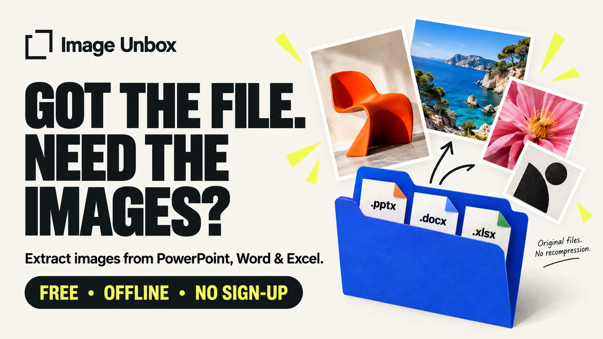

# Image Unbox

Extract embedded images from PowerPoint, Word and Excel, locally in a browser.

Download the release, unzip it and open `Image-Unbox.html` in desktop Chrome
or Edge. Click **Try the sample** to test it immediately. No installation,
server or build step is required.

Features: batch extraction, previews, format and size filters, byte-identical
duplicate detection, individual image saves, ZIP export and an optional CSV.

Supported inputs: standard, unencrypted PPTX, DOCX and XLSX. PDF, legacy Office
formats, protected files and externally linked pictures are not supported.
The tool preserves embedded image bytes; it does not render slides or recover
resolution that was previously lost.

The editable source is inside the HTML file. Code is licensed under MIT;
the full license and operating limits are included in START-HERE.txt.

Live demo: https://rsaxena3011.github.io/image-unbox/
